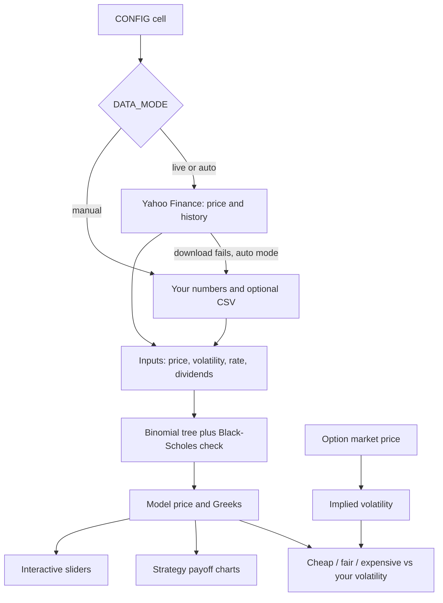

# Binomial Option Pricer for NSE Stocks

Price a stock option with a **binomial tree**, using **live data or numbers you type in yourself**.
Built around Reliance Industries (NSE), but you can change it to any NSE stock in one line.

> **Educational tool. Not investment advice.** A model price is an opinion built on assumptions, not a guarantee. Read [Accuracy and limits](#9-accuracy-and-limits) before relying on any number.

[Open in Colab](https://colab.research.google.com/github/YOUR-USERNAME/binomial-option-pricer/blob/main/binomial_option_pricer.ipynb) (replace `YOUR-USERNAME` with your GitHub name after you upload the repo)

---

## Two notebooks: start with the simple one

| Notebook | For | Size |
|---|---|---|
| `binomial_tree_simple.ipynb` | **Learning the binomial tree.** Type a few numbers, see every step of the tree, watch the price approach Black-Scholes, optionally compare with a market price. | About 80 lines of code, no downloads |
| `binomial_option_pricer.ipynb` | **Using it on real market data.** Live or manual inputs, volatility methods, implied volatility, Greeks, strategies, sliders, self-tests. | Large. Everything below this table is about this one. |

---

## Contents

1. [What you get](#1-what-you-get)
2. [Quick start](#2-quick-start)
3. [The CONFIG cell: live mode and manual mode](#3-the-config-cell-live-mode-and-manual-mode)
4. [Where to find each number](#4-where-to-find-each-number)
5. [The theory in very simple language](#5-the-theory-in-very-simple-language)
6. [The full process, step by step](#6-the-full-process-step-by-step)
7. [Worked example (Reliance)](#7-worked-example-reliance)
8. [Interactive explorer](#8-interactive-explorer)
9. [Accuracy and limits](#9-accuracy-and-limits)
10. [What has been tested](#10-what-has-been-tested)
11. [Troubleshooting and FAQ](#11-troubleshooting-and-faq)
12. [Project structure and credits](#12-project-structure-and-credits)

---

## 1. What you get

| Feature | What it does |
|---|---|
| **Live or manual inputs** | Pull the price and history from Yahoo Finance, or type every number yourself. Both live in one config cell. |
| **Volatility: past or market** | Measure it from past prices (close-to-close, EWMA, Parkinson), or take the **implied volatility** from a real option's market price. |
| **Binomial tree pricer** | Fast tree for calls and puts, European or American, with dividends. |
| **Black-Scholes cross-check** | Confirms the tree price. They should agree within a few paise. |
| **Implied volatility** | Type in the option's market price, get the volatility the market is assuming. |
| **Cheap / fair / expensive check** | Compares the market price with your model price, with a buffer for costs. |
| **Greeks** | Delta, gamma, vega, theta, rho in plain rupees. |
| **Strategy builder** | Covered call, protective put, bull call spread, bear put spread, straddle, strangle, or your own legs. Profit and loss chart per lot. |
| **Interactive sliders** | Move price, strike, volatility, rate, days and watch everything update. |
| **Self-tests** | 18 automatic checks run every time, so a broken setup is caught early. |

---

## 2. Quick start

### On your computer

```bash
git clone https://github.com/YOUR-USERNAME/binomial-option-pricer.git
cd binomial-option-pricer

python -m venv .venv
source .venv/bin/activate        # Windows: .venv\Scripts\activate
pip install -r requirements.txt

jupyter lab                      # then open binomial_option_pricer.ipynb
```

1. Open `binomial_option_pricer.ipynb`.
2. Edit **only the CONFIG cell** (section 1 of the notebook).
3. Click **Run All**.
4. Read the tables and charts from top to bottom.

Run the notebook from the repository folder, so the relative path `data/RELIANCE_sample_prices.csv` is found.

### In Google Colab

```python
!git clone https://github.com/YOUR-USERNAME/binomial-option-pricer.git
%cd binomial-option-pricer
!pip install -q yfinance ipywidgets
```

Then open the notebook from the cloned folder and run it.

### Try it with no internet

The default `DATA_MODE = "auto"` tries a live download first. If that fails, it falls back to the numbers in `MANUAL` and the bundled sample prices, and tells you so. You can run the whole notebook offline.

---

## 3. The CONFIG cell: live mode and manual mode

Everything you may want to change is in one cell. The most important setting is `DATA_MODE`:

| `DATA_MODE` | What happens |
|---|---|
| `"live"` | Download price and history from Yahoo Finance. If it fails, you get a clear error. |
| `"manual"` | Never touches the internet. Uses only what you typed into `MANUAL`. |
| `"auto"` (default) | Tries live first. If that fails, uses `MANUAL` and prints a warning. |

### How each number is chosen

| Number | Live mode | Manual mode |
|---|---|---|
| Stock price | Yahoo last price (delayed about 15 minutes) | `MANUAL["spot"]`, or the last close in your CSV if you leave it `None` |
| Price history | Yahoo, 2 years of daily data | `MANUAL["price_csv"]` (optional) |
| Volatility | Estimated from history | `MANUAL["volatility"]` if set. **It overrides the estimate even in live mode.** |
| Risk-free rate | You always type it (no free live source) | `MANUAL["risk_free_rate"]` |
| Dividend yield | You always type it | `MANUAL["dividend_yield"]` |
| Option's market price | Optional: type it, or try the experimental NSE fetch | `market_option_price`, or `market_bid` and `market_ask` |

### Typical setups

**A. Live data (internet, yfinance installed)**
```python
DATA_MODE = "live"
MANUAL = {"spot": None, "volatility": None, "risk_free_rate": 0.0557, "dividend_yield": 0.0,
          "price_csv": None, "market_option_price": None, "market_bid": 57.0, "market_ask": 59.0}
```

**B. Fully manual (offline, you type everything)**
```python
DATA_MODE = "manual"
MANUAL = {"spot": 1202.0, "volatility": 0.21, "risk_free_rate": 0.0557, "dividend_yield": 0.0,
          "price_csv": None, "market_option_price": None, "market_bid": None, "market_ask": None}
```

**C. Manual price history from a file**
```python
DATA_MODE = "manual"
MANUAL = {"spot": None, "volatility": None, "risk_free_rate": 0.0557, "dividend_yield": 0.0,
          "price_csv": "data/my_prices.csv", ...}
```
The CSV needs columns `Date` and `Close`. Optional: `High`, `Low` (for the Parkinson method) and `gap` (put `1` on a row if trading days just before it are missing from your data; that return is then skipped).

**D. Use implied volatility instead of history**
```python
VOL_METHOD = "implied"
IV_REFERENCE = {"option": "call", "strike": 1200.0, "price": None, "bid": 57.0, "ask": 59.0}   # the at-the-money option, same expiry
STRIKE = 1300.0                                                                                  # the option you want to value
```
The notebook works out the volatility hidden in the 1,200 call's price and uses it to value the 1,300 call. It still shows the historical volatility next to it for comparison. If you only know the IV your broker shows, type it into `MANUAL["volatility"]` instead (as a decimal, 20.3% is `0.203`). A typed `MANUAL["volatility"]` always wins over `VOL_METHOD`.

### All settings

| Setting | Meaning |
|---|---|
| `SYMBOL`, `YF_TICKER` | NSE symbol and Yahoo ticker (`RELIANCE.NS`, `TCS.NS`, ...). |
| `OPTION_TYPE` | `"call"` or `"put"`. |
| `STRIKE` | Strike price in rupees. |
| `EXPIRY_DATE` | `"YYYY-MM-DD"` (in quotes). Best practice: type the exact date from your broker. `None` picks the nearest upcoming monthly expiry (last Tuesday, moved back for holidays in `EXCHANGE_HOLIDAYS`) and prints "picked automatically". |
| `EXCHANGE_HOLIDAYS` | NSE weekday holidays, used only to move the automatic expiry. Pre-filled for Oct to Dec 2026 from a public holiday table (includes 24 Nov 2026). Check it on nseindia.com and add later dates yourself. |
| `LOT_SIZE` | Shares per contract (Reliance: 500 at the time of writing, check your broker). |
| `EXERCISE` | `"european"` (what NSE stock options are) or `"american"`. |
| `VALUATION_DATE` | `None` = today. Set a date to price as of a past day (history after that date is ignored). |
| `VOL_METHOD` | `"close"`, `"ewma"`, `"parkinson"` (all from past prices) or `"implied"` (from a real option's market price, see `IV_REFERENCE`). |
| `IV_REFERENCE` | Used only with `VOL_METHOD = "implied"`. The option whose price gives the volatility: `{"option": "call", "strike": 1200.0, "price": None, "bid": 57.0, "ask": 59.0}`. It must have the **same expiry** as the option you are pricing. Give `price` or both `bid` and `ask`. |
| `VOL_WINDOW` | Days of history for the estimate (63 is about 3 months). |
| `TREE_STEPS` | Steps in the tree. 300 to 1000 is plenty. |
| `DIVIDENDS` | Known cash dividends before expiry, e.g. `[("2026-12-01", 5.0)]`. |
| `EDGE_BUFFER_PCT` | Ignore model-vs-market gaps smaller than this % of the model price. |
| `FETCH_NSE_QUOTE` | Experimental: try to read the option's price from NSE's website. |
| `STRATEGY`, `STRATEGY_WIDTH` | Which strategy to draw, and the gap between strikes. |
| `CUSTOM_LEGS` | Your own legs when `STRATEGY = "custom"`. |

---

## 4. Where to find each number

| Number | Where to look |
|---|---|
| Stock price and history | Live from Yahoo, or download "Historical Data" from Yahoo Finance or your broker as CSV. |
| Option market price (bid, ask, last) | Your broker's option chain, or NSE's option chain page. Use the **middle of bid and ask**. The last traded price can be old for rarely traded strikes. |
| Strike, expiry, lot size | Your broker's order window. NSE stock derivatives expire on the **last Tuesday of the month** (since September 2025); if that day is a holiday the expiry moves to the previous trading day (for example, 24 Nov 2026 is a holiday, so that month's expiry is expected on 23 Nov). The safest way is to type `EXPIRY_DATE` yourself from your broker's screen. Lot sizes are revised by the exchange from time to time. |
| Risk-free rate | The **91-day T-bill cut-off yield** from the latest RBI T-bill auction press release on rbi.org.in (auctions are weekly, on Wednesdays). Type it as a decimal: 5.57% is `0.0557`. **Update it every week or two.** The notebook treats it as a continuous rate; the difference from the quoted yield is tiny. |
| Dividends | The company's announcements on NSE or BSE. If an ex-dividend date falls before your expiry, add it to `DIVIDENDS` as `("YYYY-MM-DD", rupees_per_share)`. |

---

## 5. The theory in very simple language

### 5.1 What an option is
* A **call option** gives you the right (not the duty) to **buy** a share at a fixed price, the **strike**, on or before a fixed date, the **expiry**.
* A **put option** gives you the right to **sell** at the strike.
* You pay a price for that right, the **premium**.
* At expiry a call is worth `max(price - strike, 0)`. A put is worth `max(strike - price, 0)`. You never exercise at a loss, so the value cannot be negative.

### 5.2 The big question
*What is a fair premium today?* Nobody knows where the stock will be at expiry. The trick is that you do not need to know. You only need to know how much it can **wiggle**.

### 5.3 The tree
Pretend that in each small time step the stock can do only two things: go **up** by a factor `u`, or go **down** by a factor `d`. Repeat that many times and you get a tree of possible prices.

```
                        up-up
                 up
          today        up-down = down-up
                 down
                        down-down
```

The size of `u` and `d` comes from the volatility (below):

```
u = e^(volatility x sqrt(dt))      d = 1 / u        dt = time per step
```

More steps means smaller, more realistic moves. With 500 steps the tree is very fine.

### 5.4 Why a fair price exists (no free lunch)
You can **copy** an option with shares plus borrowed money. Because the copy and the option behave the same, they must cost the same, otherwise someone could earn risk-free money (an **arbitrage**). That cost is the fair price.

A one-step example. The stock is 100 and can become 120 or 80. A call with strike 90 pays 30 if the stock goes up and 0 if it goes down. The interest rate is zero.

* Buy **0.75 shares** (cost 75) and **borrow 60**. Net cost: `75 - 60 = 15`.
* If the stock goes to 120: shares are worth 90, repay 60, left with **30**. Same as the option.
* If the stock goes to 80: shares are worth 60, repay 60, left with **0**. Same as the option.

So the option is worth **15**. No opinion about where the stock goes was needed.

### 5.5 Risk-neutral probability, the shortcut
The price above equals an average of the two payoffs, using a special weight `p`:

```
p = (e^(r x dt) - d) / (u - d)         price = e^(-r x dt) x ( p x payoff_up + (1 - p) x payoff_down )
```

In the example, `p = (1 - 0.8) / (1.2 - 0.8) = 0.5`, and `0.5 x 30 + 0.5 x 0 = 15`.

`p` is **not** the real chance of the stock going up. It is a mathematical weight that makes the prices consistent with no free lunch. That is why the model predicts no stock direction.

### 5.6 Working backwards
1. Build the stock tree **forward** from today's price.
2. At expiry, write down what the option pays at every end point.
3. Step back one level: each node = discounted average of the two nodes after it, using `p`.
4. Keep going back. The first node is **today's price of the option**.

This is called backward induction. The notebook does it with whole rows of numbers at once, so 500 steps take a blink.

### 5.7 Volatility
Volatility is how much the stock typically moves in a year, as a percentage. 21% means a typical one-year move of about 21%.

The notebook estimates it from past daily price changes (log returns), then scales to a year with `x sqrt(252)` because there are about 252 trading days.

| Method | Idea |
|---|---|
| `close` | Standard deviation of daily returns over the last `VOL_WINDOW` days. The default. |
| `ewma` | Like `close`, but recent days count more (decay 0.94). Reacts faster to new turbulence. |
| `parkinson` | Uses each day's high and low, which captures more of the day's movement. Needs High/Low data. |
| `implied` | Not from the past at all. Takes the volatility from a real option's market price (see 5.11). |

**This is the one input that is a guess.** Past volatility does not promise future volatility. Methods that use past prices are called *historical volatility* (HV).

### 5.8 Interest rate and dividends
* The **rate** discounts future money back to today. The notebook uses the 91-day T-bill yield.
* **Dividends** lower the stock price when they are paid, which lowers call values and raises put values. A known cash dividend before expiry is handled by subtracting its present value from today's price. A steady dividend yield can be entered as `dividend_yield`.

### 5.9 European or American
* **European**: you can use the option only at expiry.
* **American**: you can use it any time.

NSE stock options are **European** and settled by **physical delivery**. So `EXERCISE = "european"` is right for them. The notebook also supports American options (it checks "is exercising now worth more than waiting?" at every node) because many other markets use them.

### 5.10 Black-Scholes cross-check
Black-Scholes is a formula that gives the answer a tree would reach with infinitely many steps. The notebook prints both. If they differ by more than 2%, it asks you to raise `TREE_STEPS`.

### 5.11 Implied volatility (the model run backwards)
Normal use: volatility in, price out. Implied volatility reverses it: **market price in, volatility out**. It is the volatility the market is assuming. Traders compare it with their own estimate.

**Can I use implied volatility (IV) instead of historical volatility (HV) as the input?** Yes: set `VOL_METHOD = "implied"`. But know what it does:

| | Historical (HV) | Implied (IV) |
|---|---|---|
| Comes from | Past stock prices | Today's option prices |
| Looks | Backwards | Forwards: includes what traders expect (results, events, fear) |
| Good for | An **independent opinion** to test the market against | Pricing other strikes and strategies **consistently with the market**, and realistic Greeks |
| Catch | The past may not repeat | Only as good as the quote you type in. Last prices of rarely traded strikes can be stale. |

**The circular trap:** if you price an option using *its own* IV, the model price comes out equal to the market price by definition. The verdict will always say "about fair" and tells you nothing. The notebook warns you if you do this. To get a real signal, take the IV from a *different* option (usually the at-the-money one with the same expiry) and use it to value your strike.

Two more things to remember. First, IV is different at different strikes (the "smile"), so the IV of the at-the-money option is only a rough guide for a far-away strike; a neighbouring strike is better. Second, an IV shown by your broker or NSE can differ a little from the notebook's, because of different rate, dividend or day-count choices.

### 5.12 The Greeks (how the price reacts)

| Greek | In plain words |
|---|---|
| **Delta** | Rupees the option moves when the stock moves Rs 1. Also the shares you hold to hedge one short option. |
| **Gamma** | How much delta itself changes when the stock moves Rs 1. |
| **Vega** | Rupees gained when volatility rises by 1 point. |
| **Theta** | Rupees lost per day just from time passing. |
| **Rho** | Rupees gained when the interest rate rises by 1 point. |

### 5.13 Put-call parity
For European options, `call - put = stock price (adjusted for dividends) - strike discounted`. If a model breaks this, it has a bug. The self-tests check it.

### 5.14 "Cheap" and "expensive"
The notebook compares the **market price** with the **model price at your volatility**:

* Market well below model: the market is assuming less movement than you. The option looks **cheap**.
* Market well above model: the market is assuming more. It looks **expensive**.
* Within your buffer (the larger of `EDGE_BUFFER_PCT` and half the bid-ask gap): **about fair**.

This is *relative to your volatility*. If your volatility is wrong, the signal is wrong. The market may also know about news your price history does not.

### 5.15 Strategies in one line each

| Strategy | Legs | What it bets on |
|---|---|---|
| Covered call | Own the stock, sell a call | Stock stays flat or rises a little. You earn the premium. |
| Protective put | Own the stock, buy a put | You want insurance against a fall. |
| Bull call spread | Buy a call, sell a higher call | Stock rises, with limited cost and limited profit. |
| Bear put spread | Buy a put, sell a lower put | Stock falls, with limited cost and limited profit. |
| Long straddle | Buy a call and a put, same strike | A **big move**, either direction. |
| Long strangle | Buy a higher call and a lower put | A bigger big move, cheaper entry. |

---

## 6. The full process, step by step



| Notebook section | What happens |
|---|---|
| 1. CONFIG | You set the option and choose live or manual inputs. |
| 2. Setup | Imports, small helpers, and a check that your config makes sense. |
| 3. Volatility | Functions that turn price history into a yearly volatility (historical volatility). |
| 4. Pricing engine | Tree, Black-Scholes, Greeks, implied volatility. |
| 5. Inputs | Live download or manual values. With `VOL_METHOD = "implied"` the volatility is worked out here from `IV_REFERENCE`. Mistakes such as typing `21` instead of `0.21` stop with a clear message. A table shows every input and where it came from. |
| 6. Self-tests | 18 checks against known answers. If one fails, the notebook stops. |
| 7. Price your option | Model price, per-lot value, time value, and a tiny 3-step tree you can read by eye. |
| 8. Market vs model | Implied volatility and the cheap / fair / expensive verdict. |
| 9. Greeks | Table plus plain-language lines (hedge size, daily time decay). |
| 10. Charts | Price and rolling volatility, convergence, value vs stock price, price vs volatility. |
| 11. Strategy builder | Legs, cost, best and worst case, break-evens, profit-and-loss chart. |
| 12. Interactive explorer | Sliders. |
| 13. Warnings and reality checks | Everything that deserves a second look. |

**A sensible routine for each use**

1. Update the risk-free rate (weekly is enough).
2. Set strike, expiry and lot size to match your broker screen.
3. Run the notebook.
4. Type the option's bid and ask into `MANUAL` and run again.
5. Read the implied volatility and the verdict. Ask *why* the market might disagree with you.
6. Try the strategy chart and the sliders before deciding anything.

---

## 7. Worked example (Reliance)

Sample run with the bundled data: priced as of **21 Oct 2026**, expiry **20 Jan 2027** (91 days), strike 1,200, European call.

| Input | Value |
|---|---|
| Stock price | Rs 1,202.00 (close of 19 Oct 2026) |
| Volatility | 21.05% (63 daily returns, close-to-close) |
| Risk-free rate | 5.57% (91-day T-bill, auction of 7 Oct 2026) |

| Result | Value |
|---|---|
| Model price (500 steps) | **Rs 59.81** per share, Rs 29,907 per lot of 500 |
| Black-Scholes check | Rs 59.81 |
| Intrinsic / time value | Rs 2.00 / Rs 57.81 |
| Delta / gamma | 0.58 / 0.0031 |
| Vega / theta / rho | 2.35 per vol point / -0.37 per day / 1.59 per 1% |

**How the tree gets closer:** a 3-step tree gives Rs 63.95, 500 steps give Rs 59.81, and Black-Scholes gives Rs 59.81.


**The price depends strongly on volatility.** Same option, different volatility: about Rs 46 at 15%, Rs 60 at 21%, Rs 81 at 30%.


**Strategy example, bull call spread** (buy the 1,200 call at 59.81, sell the 1,300 call at 21.52): you pay Rs 19,146 per lot, the most you can make is Rs 30,854, the most you can lose is Rs 19,146, and break-even at expiry is about Rs 1,238.


**Reading the verdict (invented numbers, for illustration only).** If the bid is 57 and the ask is 59, the middle is 58. The model says 59.81, a gap of Rs 1.81 per share. The buffer is Rs 2.99 (5% of the model price), so the verdict is "about fair". The market's implied volatility would be 20.28% against your 21.05%.

The prices above come from the bundled sample data, which ends on 19 Oct 2026. They are not live quotes.

---

## 8. Interactive explorer

Section 12 of the notebook builds sliders (needs `ipywidgets`, included in `requirements.txt`).

| Slider | Try this |
|---|---|
| Stock price | Drag it up and down and watch the price curve and the delta change. |
| Strike | Move to out-of-the-money strikes, the price collapses. |
| Volatility % | Double it and see the price jump. This is vega at work. |
| Interest rate % | Small effect for short options. |
| Days to expiry | Shrink it and watch the "value today" curve fall onto the "value at expiry" line. That is theta. |
| Type, Exercise | Compare call vs put and European vs American. American puts cost more. |
| Tree steps | Low numbers show the tree's rough edges. |

The line above the chart shows price per share, price per lot, and all five Greeks. The explorer ignores discrete dividends (it uses the dividend yield only).

If the sliders do not appear, see the [FAQ](#11-troubleshooting-and-faq). You can always call `explore(spot=1250, vol_pct=25)` by hand.

---

## 9. Accuracy and limits

Honest list of what this notebook cannot do for you:

1. **Volatility is a guess.** History does not promise the future. Results, budgets, oil shocks and global events change it fast. This is the biggest source of error. Implied volatility swaps that guess for the market's view, but it is only as good as the option quote you feed in.
2. **One flat volatility per option.** Real markets show a "smile": far strikes trade at different implied volatilities. Far out-of-the-money options will show gaps against the market that are not mistakes.
3. **Delayed data.** Yahoo's NSE prices are delayed (about 15 minutes) and can be missing or wrong. For trading decisions use your broker's live feed.
4. **Interest rate is typed by you.** It goes stale if you forget to update it. Its effect on a 3-month option is small, but not zero.
5. **Dividends are simplified.** Known cash dividends are handled by subtracting their present value. American options with dividends are only approximated.
6. **Costs are not in the price.** Brokerage, STT, exchange fees, taxes and the bid-ask gap can erase a small edge.
7. **Physical settlement.** In-the-money NSE stock options at expiry mean shares change hands, which needs cash or shares in your account.
8. **Expiry holidays.** The automatic expiry is the last Tuesday of the month, moved back only for the holidays you list in `EXCHANGE_HOLIDAYS`. That list is pre-filled for Oct to Dec 2026 only. Always confirm the expiry with your broker, or type `EXPIRY_DATE` yourself.
9. **Illiquid strikes.** The last traded price can be hours old. Prefer the middle of bid and ask.

Good habits: compare the model with **several** strikes, check **implied volatility** rather than only "cheap or expensive", and never risk money you cannot afford to lose. Selling options can lose far more than you receive.

---

## 10. What has been tested

* **Math:** 18 self-tests pass. They reproduce a textbook tree (29.38 for a known example), match Black-Scholes, satisfy put-call parity, recover a known implied volatility (including for a 6-day American put), check American vs European behaviour, and check the expiry-date and date-reading helpers, and recover a volatility from a reference option's bid/ask.
* **Notebook:** executed from top to bottom in a clean Jupyter kernel, offline, with no errors, and the charts in `docs/` come from that run. The slider cell runs without errors, but the slider screen itself could not be viewed in a live browser session while building, so look at it on your first run.
* **Configurations:** all of these were re-run end to end just before release with no errors: call and put, European and American, all six strategies and a custom one, EWMA volatility, dividends, bid/ask and last-price market inputs, and manual mode with no CSV. Bad inputs give clear messages: volatility typed as `21`, unknown option type, expiry before valuation date, no price history, and live mode with no internet.
* **Implied-volatility mode:** tested with invented quotes (not real NSE prices): it recovers a known volatility, prices a different strike from a reference option, warns when the reference is the option being priced, lets a typed `MANUAL["volatility"]` win, works with no price history, and gives clear errors for a missing or impossible reference price. It has not been compared with real NSE quotes.
* **Live-data code:** tested with **mock Yahoo data** (time-zone-aware dates, duplicate rows, a zero-volume holiday row, Parkinson volatility, automatic expiry). It could **not** be tested against the real Yahoo Finance or NSE sites from the build environment. Your first live run is the real test. If it fails, `auto` mode falls back to your manual inputs.
* **NSE quote helper (`FETCH_NSE_QUOTE`):** experimental. Only its parsing was tested, on mock data. NSE changes its website often and may block scripts. For dependable prices use your broker's API or type the price in. Check NSE's terms before automating.

---

## 11. Troubleshooting and FAQ

**"A date must be written inside quotes" (or "Invalid isoformat string: '1989'").**
Dates are text, so they need quotes: `EXPIRY_DATE = "2026-10-27"`. Without quotes, Python reads `2026-10-27` as a subtraction and gets the number 1989. The notebook also accepts `"27-10-2026"`, `"27/10/2026"` and `"27-Oct-2026"`. The same rule applies to the dates inside `DIVIDENDS`.

**The automatic expiry is not the one my broker shows.**
`None` picks the nearest upcoming last-Tuesday expiry and moves it back for holidays in `EXCHANGE_HOLIDAYS`. If your broker shows another date (a holiday not in the list, or a rule change), type `EXPIRY_DATE = "YYYY-MM-DD"` yourself.

**Can I use implied volatility instead of historical?**
Yes. Set `VOL_METHOD = "implied"` and fill in `IV_REFERENCE` (section 3 setup D, theory in 5.11). If you only have the IV from your broker, type it into `MANUAL["volatility"]`.

**The live download fails.**
Check your internet, run `pip install -U yfinance`, and make sure the ticker ends in `.NS`. Yahoo sometimes rate-limits; wait a minute. In `auto` mode the notebook falls back to your manual inputs and prints the reason. Or switch to `DATA_MODE = "manual"`.

**"No price history to estimate volatility."**
You are offline and the CSV path did not resolve. Run the notebook from the repository folder, or type your own number into `MANUAL["volatility"]`.

**"Volatility 21.0 looks wrong."**
Use decimals: `0.21` is 21%. The same goes for the rate (`0.0557`) and dividend yield.

**"Risk-neutral probability p is outside 0..1."**
The tree is too coarse for your rate and volatility. Increase `TREE_STEPS`.

**"History ends N days before the valuation date."**
Your data is old. Re-download, use live mode, or accept a less accurate volatility.

**The tree and Black-Scholes differ.**
Small differences (a few paise) are normal. Increase `TREE_STEPS` to shrink them. American options have no Black-Scholes reference.

**The sliders do not show.**
Run `pip install ipywidgets` and restart the kernel. VS Code needs its Jupyter extension. Colab works out of the box.

**Why does my broker show a different price?**
The market price comes from supply and demand, not from this model. Reasons for a gap: different volatility, the volatility smile, the bid-ask gap, delayed data, a stale rate, and dividends.

**Can I use it for another stock?**
Yes. Change `SYMBOL`, `YF_TICKER`, `STRIKE`, `LOT_SIZE`, and your sample CSV or live data. Check the lot size and strike steps with your broker.

**Can I price index options (Nifty)?**
The pricing maths works for an index too (index options are European and cash-settled). Set `YF_TICKER = "^NSEI"`, enter the strike, lot size and expiry date yourself (the automatic expiry rule is for stock options), and set `dividend_yield` to roughly the index's yield. This path is less tested than the stock path.

**Why is theta negative?**
A bought option loses time value every day. Theta is the daily cost of holding it.

---

## 12. Project structure and credits

```
binomial-option-pricer/
├── README.md                          this file
├── binomial_tree_simple.ipynb         the simple learning notebook (start here)
├── binomial_option_pricer.ipynb       the full notebook (edit the CONFIG cell, Run All)
├── requirements.txt                   Python packages
├── .gitignore
├── data/
│   └── RELIANCE_sample_prices.csv     sample daily closes, 1 Apr to 19 Oct 2026 (offline fallback)
└── docs/                              charts used in this README
```

**Ideas used** (all standard, public methods): the Cox-Ross-Rubinstein binomial model (1979), Black-Scholes-Merton option formula (1973), risk-neutral valuation, and RiskMetrics-style EWMA volatility.

**Original code:** this repository contains only original code and text. If you learned the binomial model in a paid course, do not upload that course's own notebooks or materials.

**Sample data:** the closing prices in `data/` were collected from public quote pages, are for demonstration, and may contain errors. Do not trade on them.

**Package versions tested:** Python 3.13, numpy 2.5, pandas 3.0, matplotlib 3.11, ipywidgets 8.1, yfinance 1.7. Older versions are likely fine but untested.

**Disclaimer:** this software is provided as is, for education. It is not investment advice, and the author is not responsible for trading losses.
